**In this chapter you will learn how to:**

- understand the relationship between logarithms and indices, and use the laws of logarithms (excluding change of base)
- understand the defi nition and properties of e *x* and ln *x*, including their relationship as inverse functions and their graphs
- use logarithms to solve equations and inequalities in which the unknown appears in indices
- use logarithms to transform a given relationship to linear form, and hence determine unknown constants by considering the gradient and/or intercept.

# Chapter 2

# Logarithmic and exponential functions

## What is a logarithm?

At IGCSE / O Level we learnt how to solve some simple exponential equations. For example, $32^x = 2$ can be solved by first writing 32 as a power of 2. In this chapter we will learn how to solve more difficult exponential equations such as $a^x = b$ where there is no obvious way of writing the numbers $a$ and $b$ in index form with the same base number. In order to be able to do this we will first learn about a new type of function called the logarithmic function. A logarithmic function is the inverse of an exponential function.

At IGCSE / O Level we learnt about exponential growth and decay and its applications to numerous real-life problems such as investments and population sizes. Logarithmic functions also have real-life applications such as the amount of energy released during an earthquake (the Richter scale). One of the most fascinating occurrences of logarithms in nature is that of the logarithmic spiral that can be observed in a nautilus shell. We also see logarithmic spiral shapes in spiral galaxies, and in plants such as sunflowers.

## 2.1 Logarithms to base 10

Consider the exponential function $f(x) = 10^x$ .

To solve the equation $10^x = 6$ , we could make an estimate by noting that $10^0 = 1$ and $10^1 = 10$ , hence $0 < x < 1$ . We could then try values of $x$ between 0 and 1 to find a more accurate value for $x$ .

The graph of $y = 10^x$ could also be used to give a more accurate value for $x$ when $10^x = 6$ .

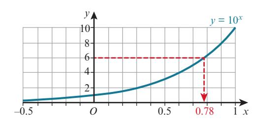

### PREREQUISITE KNOWLEDGE

| Where it comes from | What you should be able to do | Check your skills |
| --- | --- | --- |
| IGCSE / O Level Mathematics | Use and interpret positive, negative, fractional and zero indices. | **1** Evaluate. **a** $5^{-2}$ **b** $8^{\frac{2}{3}}$ **c** $7^0$ **2** Solve $32^x = 2$ . |
| IGCSE / O Level Mathematics | Use the rules of indices. | **3** Simplify. **a** $3x^{-4} \times \frac{2}{3} x^{\frac{1}{2}}$ **b** $\frac{2}{5} x^{\frac{1}{2}} \div 2x^{-2}$ **c** $\left(\frac{2x^5}{3}\right)^3$ |

Explore the *Exponentials and logarithms* station on the Underground Mathematics website.

### WEB LINK

You will encounter logarithmic functions again when studying calculus in Chapters 4, 5 and 8.

### FAST FORWARD

From the graph, $x \approx 0.78$ .

There is, however, a function that gives the value of $x$ directly:

If $10^x = 6$ then $x = \log_{10} 6$ .

$\log_{10} 6$ is read as ‘ $\log 6$ to base 10’.

#### log is short for **logarithm**.

On a calculator, for logs to the base 10, we use the $(\log)$ or $(\lg)$ key.

So if $10^x = 6$

then $x = \log_{10} 6$

$x = 0.778$ to 3 significant figures.

log10 6 can also be written as log 6 or lg 6.

### TIP

#### The rule for base 10 is:

If $y = 10^x$ then $x = \log_{10} y$

This rule can be described in words as:

lo10 *y* is the power that 10 must be raised to in order to obtain *y*.

For example, $\log_{10} 100 = 2$ since $100 = 10^2$ .

$y = 10^x$ and $y = \log_{10} x$ are inverse functions.

We say that $y = 10^x \Leftrightarrow x = \log_{10} y$ .

This is read as: $y = 10^x$ is equivalent to saying that $x = \log_{10} y$ .

### KEY POINT 2.1

**1** Discuss with your classmates why each of these two statements is true.

**2 a** Discuss with your classmates why each of these two statements is true.

**b** Discuss what the missing numbers should be in this table of values, giving reasons for your answers.

|  | log100.01 | log100.1 | log101 | log1010 | log10100 | log101000 |
| --- | --- | --- | --- | --- | --- | --- |
| ..... | ..... | ..... | 0 | 1 | ..... | ..... |

$$\log_{10} 10^x = x \text{ for } x \in \mathbb{R} \qquad 10^{\log_{10} x} = x$$

$$10^{\log_{10} x} = x \text{ for } x > 0$$

$$(\log_{10} 10 = 1)$$

$$\log_{10} 1 = 0$$

### EXPLORE 2.1

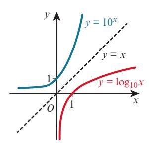

**a** Convert $10^x = 58$ to logarithmic form.
**b** Solve $10^x = 58$ giving your answer correct to 3 significant figures.

#### Answer

##### a Method 1

$$10^x = 58$$

**Step 1:** Identify the base and index $\longrightarrow$ base = 10, index = x

**Step 2:** Start to write in log form $\longrightarrow x = \log_{10} t$

**Step 3:** Complete the log form $\longrightarrow x = \log_{10} 58$

$$10^x = 58 \Leftrightarrow x = \log_{10} 58$$

##### Method 2

**b** $10^x = 58$
$x = \log_{10} 58$
$x \approx 1.76$

$$x = \log_{10} 58$$

$$10^x = 58$$

$$\log_{10}10^x = \log_{10}58$$

Take logs to base 10 of both sides.

Use $\log_{10} 10^x = x$ .

### WORKED EXAMPLE 2.1

In log form the index is always on its own.

### TIP

In log form the index is always on its own and the base goes at the base of the logarithm.

### TIP

**a** Convert $\log_{10} x = 3.5$ to exponential form.
**b** Solve $\log_{10} x = 3.5$ giving your answer correct to 3 significant figures.

#### Answer

##### a Method 1

$$\log_{10} x = 3.5$$

**Step 1:** Identify the base and index $\longrightarrow \text{base} = 10, \text{index} = 3.5$

**Step 2:** Start to write in exponential form $\longrightarrow 10^{3.5} = ?$

### EXERCISE 2A

**1** Convert from exponential form to logarithmic form.
**a** $10^2 = 100$ b $10^x = 200$ c $10^x = 0.05$
**2** Solve each of these equations, giving your answers correct to 3 significant figures.
**a** $10^x = 52$ b $10^x = 250$ c $10^x = 0.48$
**3** Convert from logarithmic form to exponential form.
**a** $\log_{10} 10\,000 = 4$ b $\log_{10} x = 1.2$ c $\log_{10} x = -0.6$
**4** Solve each of these equations, giving your answers correct to 3 significant figures.
**a** $\log_{10} x = 1.88$ b $\log_{10} x = 2.76$ c $\log_{10} x = -1.4$

**Step 3:** Complete the exponential form $\longrightarrow x = 10^{3.5}$

$$\log_{10} x = 3.5 \iff x = 10^{3.5}$$

##### Method 2

**b**

$$\log_{10} x = 3.5$$

$$\log_{10} x = 3.5$$

$$10^{\log_{10} x} = 10^{3.5}$$

$$x = 10^{3.5}$$

$$x \approx 3160$$

Write each side as an exponent of 10.

Use $10^{\log_{10} x} = x$ .

Find the value of:

a

$$\log_{10} 10\,000$$

**b**

$$\log_{10} 0.0001$$

**a** $\log_{10} 10,000$ **b** $\log_{10} 0.0001$ **c** $\log_{10} 1000\sqrt{10}$

#### Answer

**a** $\log_{10} 10\,000 = \log_{10} 10^4$
$= 4$

Write 10 000 as a power of 10, $10\,000 = 10^4$ .

**b**

$$\log_{10} 0.0001 = \log_{10} 10^{-4}$$

 $= -4$

Write 0.0001 as a power of 10, 0.0001 = 10-4.

**c**

$$\log_{10} 1000\sqrt{10} = \log_{10} 10^{3.5}$$

 $= 3.5$

Write $1000\sqrt{10}$ as a power of 10.

$$1000\sqrt{10} = 10^3 \times 10^{0.5} = 10^{3.5}.$$

**5 Without using a calculator, find the value of:**

**a**

$$\log_{10} 100$$

**b**

$$\log_{10} 0.0001$$

$a \rightarrow$ $\log_{10} 100$ $b$ $\log_{10} 0.0001$ $c$ $\log_{10}(10\sqrt{10})$

d

$$\log_{10}(\sqrt[3]{10})$$

$$\sqrt{10} )$$

**e**                      $\log_{10}(100\sqrt{10})$

f

$$\log_{10}\left(\frac{100}{\sqrt{1000}}\right)$$

**6** Given that the function $f$ is defined as $f : x \mapsto 10^x - 3$ for $x \in \mathbb{R}$ , find an expression for $f^{-1}(x)$ .

**7** Given that $p$ and $q$ are positive and that $4(\log_{10} p)^2 + 2(\log_{10} q)^2 = 9$ , find the greatest possible value of $p$ .

## 2.2 Logarithms to base a

In the last section you learnt about logarithms to the base of 10.

The same principles can be applied to define logarithms in other bases.

The conditions for $\log_a x$ to be defined are:

- $a > 0$ and $a \neq 1$
- $x > 0$

We say that $y = a^x \Leftrightarrow x = \log_a y$ .

If $y = a^x$ then $x = \log_a y$

$\log_a a = 1$ $\log_a 1 = 0$

$$\log_a a^x = x \qquad a^{\log_a x} = x$$

### KEY POINT 2.2

Try the *See the power* resource on the Underground Mathematics website.

### WEB LINK

Convert $5^3 = 125$ to logarithmic form.

#### Answer

##### Method 1

$$5^3 = 125$$

**Step 1:** Identify the base and index $\longrightarrow$ base = 5, index = 3

**Step 2:** Start to write in log form $\longrightarrow 3 = \log_3 2$

**Step 3:** Complete the log form $\longrightarrow 3 = \log_5 125$

$$5^3 = 125 \Leftrightarrow 3 = \log_5 125$$

##### Method 2

$$5^3 = 125$$

$$\log_5 5^3 = \log_5 125$$

Take logs to base 5 of both sides.

$$3 = \log_5 125$$

..... Use $\log_5 5^x = x$ .

### WORKED EXAMPLE 2.4

In log form the index is always on its own and the base goes at the base of the logarithm.

### TIP

Convert $\log_3 x = 2.5$ to exponential form.

#### Answer

##### Method 1

$$\log_3 x = 2.5$$

**Step 1:** Identify the base and index $\longrightarrow$ base = 3, index = 2.5

$\longrightarrow$ base = 3, index = 2.5

**Step 2:** Start to write in exponential form $\longrightarrow 3^{2.5} = 1$

$\longrightarrow 3^{2.5} = ?$

##### Step 3: Complete the exponential form

$$\log_3 x = 2.5 \iff 3^{2.5} = x$$

$\longrightarrow 3^{2.5} = x$

##### Method 2

$$\log_3 x = 2.5$$

$$x = 3^{2.5}$$

$$3^{\log_3 x} = 3^{2.5}$$

##### Write each side as an exponent of 3.

Use $3^{\log_3 x} = x$

### WORKED EXAMPLE 2.5

In log form the index is always on its own.

### TIP

Find the value of:

a

$$\log_2 16$$

b $\log$

b

$$\log_3 \frac{1}{9}$$

#### Answer

a)

$$\log_2 16 = \log_2 2^4$$

 $= 4$

Write 16 as a power of 2, $16 = 2^4$ .

$$\begin{aligned} \text{b} \quad \log_3 \frac{1}{9} &= \log_3 3^{-2} \\ &= -2 \end{aligned}$$

Write $\frac{1}{9}$ as a power of 3, $\frac{1}{9} = 3^{-2}$ .

### EXERCISE 2B

**1** Convert from exponential form to logarithmic form.

<!-- CHECK: page 8: equation OCR failed, bbox [94, 294, 146, 312]: a 52 = 5 -->

$$b^2 = 25$$

**b**      $2^4 = 16$

c

$$3^{-5} = \frac{1}{243}$$

$$5 = \frac{1}{243}$$

**d**      $2^{-10} = \frac{1}{1024}$

e

$$8^x = 15$$

f

$$x^y = 6$$

$$y = 6$$

**g**      $a^b = c$

$$t^b = c$$

**h**      $x^{5y} = 7$

**2** Convert from logarithmic form to exponential form.

a

$$\log_2 8 = 3$$

b

$$\log_3 81 = 4$$

**c**

$$\log_8 1 = C$$

**a** $\log_2 8 = 3$ **b** $\log_3 81 = 4$ **c** $\log_8 1 = 0$ **d** $\log_{16} 4 = \frac{1}{2}$

e

$$\log_8 2 = \frac{1}{3}$$

$$g_2 = \frac{1}{2}$$

f      $\log_2 y = 4$      g      $\log_a 1 = 0$      h      $\log_x 5 = y$

$$g - \log_a 1 \equiv 0 \pmod{p}$$

h

$$\log_c 5 = y$$

**3** Solve.

**a** $\log_2 x = 3$ b $\log_3 x = 2$ c $\log_4 x = 0$ d $\log_5 x = 2$

**4** Solve.

**a**

$$\log_3(x+5) = 2$$

**b**

$$\log_2(3x - 1) = 5$$

a

$$\log_3(x+5) = 2$$

b $\log_2(3x-1) = 5$      c $\log_p(7-2x) = 0$

**5** Find the value of:

a

$$\log_3 27$$

a

$$\log_3 27$$

b $\log_6 36$      c $\log_4 2$      d $\log_2 10$

c

$$\log_4 2$$

d

$$\log_2 0.125$$

e

$$\log_4\left(\frac{1}{16}\right)$$

**f** $\log_5(5\sqrt{5})$ g $\log_5$

$$g = \log_3\left(\frac{\sqrt{3}}{3}\right)$$

**h**

$$\log_7\left(\frac{\sqrt[3]{7}}{7}\right)^2$$

**6** Simplify.

a

$$\log_x x^3$$

b

$$\log_x \sqrt[3]{x}$$

$$x_x \sqrt[3]{x}$$

**c**    $\log_x(x^2\sqrt{x})$      **d**    $\log$

d

$$\log_x \frac{1}{x^4}$$

e

$$\log_x\left(\frac{1}{x^3}\right)^2$$

f

$$\log_x\left(\sqrt{x^5}\right)$$

$$g = \log_x\left(\frac{x}{\sqrt{x}}\right)$$

$$x \left( \frac{x}{\sqrt[3]{x}} \right)$$

**h**      $\log_x \left( \frac{x^2}{\sqrt{x}} \right)^3$

**7** Given that the function $f$ is defined as $f: x \mapsto 1 + \log_2(x - 3)$ for $x \in \mathbb{R}$ , $x > 3$ , find an expression for $f^{-1}(x)$ .

**8** Solve.

**a**

$$\log_2(\log_3 x) = -1$$

**b**

$$\log_4 2^{3-5x} = x^2$$

**PS**

Simplify *x* *x* *x* log. 3

**Answer**

$$\log_x\left(\frac{\sqrt[3]{x}}{x}\right) = \log_x\left(x^{-\frac{2}{3}}\right) \\ = -\frac{2}{3}$$

Write 3 *x* *x* as a power of *x*.

### WORKED EXAMPLE 2.7

a

$$\log_2 x = 3$$

**b**

$$\log_3 x = 2$$

**c**

$$\log_4 x = 0$$

Try the *Logarithm*  *lattice* resource on the Underground Mathematics website.

**9** **WEB LINK**

Without using a calculator, arrange these logarithms in ascending order.

Add some more logarithms of your own in the correct position in your ordered list.

## 2.3 The laws of logarithms

If $x$ and $y$ are both positive and $a > 0$ and $a \neq 1$ , then the following **laws of logarithms** can be used.

### Proofs:

#### Multiplication law Division law Power law

$$\begin{aligned} & \log_a(xy) \\ &= \log_a(a^{\log_a x} \times a^{\log_a y}) \\ &= \log_a(a^{\log_a x + \log_a y}) \\ &= \log_a x + \log_a y \end{aligned}$$

$$\begin{aligned} & \log_a\left(\frac{x}{y}\right) \\ &= \log_a\left(\frac{a^{\log_a x}}{a^{\log_a y}}\right) \\ &= \log_a(a^{\log_a x - \log_a y}) \\ &= \log_a x - \log_a y \end{aligned}$$

$$\begin{aligned} \log_a(x)^m &= \log_a((a^{\log_a x})^m) \\ &= \log_a(a^{m \log_a x}) \\ &= m \log_a x \end{aligned}$$

Using the power law, $\log_a\left(\frac{1}{x}\right) = \log_a x^{-1}$
 $= -\log_a x$

**1** Prya and Hamish are asked what they think $\log_{10} 12 + \log_{10} 4$ simplifies to.

Prya says that: $\log_{10} 12 + \log_{10} 4 = \log_{10}(12 + 4) = \log_{10} 16$

Hamish says that: $\log_{10} 12 + \log_{10} 4 = \log_{10}(12 \times 4) = \log_{10} 48$

Use a calculator to see who is correct and check that their rule works for other pairs of numbers.

**2** Can you predict what $\log_{10} 12 - \log_{10} 4$ simplifies to?

Use a calculator to check that you have predicted correctly and check for other pairs of numbers.

### EXPLORE 2.2

|  |  |  |  |
| --- | --- | --- | --- |
| **Multiplication law** | **Division law** | **Power law** |  |
| $\log_a(xy) = \log_a x + \log_a y$ | $\log_a\left(\frac{x}{y}\right) = \log_a x - \log_a y$ | $\log_a(x)^m = m \log_a x$ |  |

### KEY POINT 2.3

**PS** log93

log82

log23 0 log43

log22

log34

log32

Another useful rule to remember:

Use the laws of logarithms to simplify these expressions.

**a**

$$\log_2 3 + \log_2 5$$

**b**

$$\log_3 8 - \log_3 4$$

**a**

$$\log_2 3 + \log_2 5$$

**b** $\log_3 8 - \log_3 5$      **c** $2 \log_5 2 + \log_5 3$

**Answer**

a

$$\log_2 3 + \log_2 5$$

$$= \log_2(3 \times 5)$$

$$= \log_2 15$$

**b**

$$\log_3 8 - \log_3 4$$

$$= \log_3\left(\frac{8}{4}\right)$$

$$= \log_3 2$$

**c**

$$2 \log_5 2 + \log_5 3$$

$$= \log_5 2^2 + \log_5 3$$

$$= \log_5(4 \times 3)$$

$$= \log_5 12$$

### WORKED EXAMPLE 2.8

Given that $\log_4 p = x$ and $\log_4 q = y$ , express in terms of $x$ and/or $y$

**a**

$$\log_4 p^5 - \log_4 q^2$$

$p^5 - \log_4 q^2$ $b$ $\log_4 \sqrt{p} + 5 \log_4 \sqrt[3]{q}$ $c$

c

$$\log_4\left(\frac{64}{p}\right)$$

.

**Answer**

a

$$\log_4 p^5 - \log_4 q^2$$

$$= 5 \log_4 p - 2 \log_4 q$$

$$= 5x - 2y$$

b

$$\log_4 \sqrt{p} + 5 \log_4 \sqrt[3]{q}$$

$$= \frac{1}{2} \log_4 p + \frac{5}{3} \log_4 q$$

$$= \frac{1}{2} x + \frac{5}{3} y$$

c

$$\log_4\left(\frac{64}{p}\right)$$

$$= \log_4 4^3 - \log_4 p$$

$$= 3 - x$$

### WORKED EXAMPLE 2.9

$$\log_a\left(\frac{1}{x}\right) = -\log_a x$$

### KEY POINT 2.4

### EXERCISE 2C

**1** Write as a single logarithm.

**a**

$$\log_2 7 + \log_2 11$$

**a**

$$\log_2 7 + \log_2 11$$

**b** $\log_6 20 - \log_6 4$      **c** $3\log_3 2 - \log_3 5$

**c**

$$3\log_5 2 - \log_5 4$$

**d** $2 \log_3 8 - 5 \log_3 2$ **e** $1 + 2 \log_2 3$

<!-- CHECK: page 10: equation OCR failed, bbox [227, 647, 292, 661]:  -->

<!-- CHECK: page 10: equation OCR failed, bbox [360, 647, 420, 663]: f 2l − og 4 2 -->

**2** Write as a single logarithm, then simplify your answer.

**a**

$$\log_2 40 - \log_2 5$$

**a**

$$\log_2 40 - \log_2 5$$

**b** $\log_6 20 + \log_6 5$      **c** $\log_2 60 - \log_2 5$

**c**

$$\log_2 60 - \log_2 5$$

**3** Simplify.

a $3 \log_5 2 + \frac{1}{2} \log_5 36 - \log_5 12$

b $\frac{1}{2} \log_3 8 + \frac{1}{2} \log_3 18 - 1$

**4** Express 8 and 0.25 as powers of 2 and hence simplify $\frac{\log_5 8}{\log_5 0.25}$ .

**5** Simplify.

a $\frac{\log_2 27}{\log_2 3}$

b $\frac{\log_3 128}{\log_3 16}$

c $\frac{\log_3 25}{\log_3 0.04}$

d $\frac{\log_5 1000}{\log_5 0.01}$

**6** Given that $\log_8 y = \log_8(x - 2) - 2 \log_8 x$ , express $y$ in terms of $x$ .

**7** Given that $\log_3(z - 1) - \log_3 z = 1 + 3 \log_3 y$ , express $z$ in terms of $y$ .

**8** Given that $y = \log_5 x$ , find in terms of $y$ :

a $x$

b $\log_5(25x)$

c $\log_5\left(\frac{x\sqrt{x}}{125}\right)$

d $\log_x 125$

**9** Given that $x = \log_4 p$ and $y = \log_4 q$ , express in terms of $x$ and/or $y$ :

a $\log_4(64p)$

b $\log_4\left(\frac{2}{q}\right)$

c $pq$

d $\log_4 p^2 - \log_4(4\sqrt{q})$

**10** Given that $\log_a x = 7$ and $\log_a y = 4$ , find the value of:

a $\log_a\left(\frac{x}{y}\right)$

b $\log_a\left(\frac{\sqrt{x}}{y^2}\right)$

c $\log_a(x^2\sqrt{y})$

d $\log_a\left(\frac{y}{\sqrt[3]{x}}\right)$

11

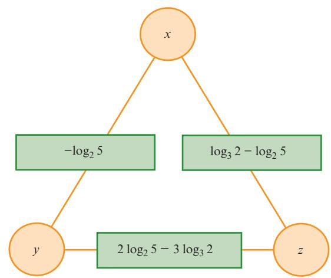

The number in the rectangle on the side of the triangle is the **sum** of the numbers at the adjacent vertices.

For example, $x + y = -\log_2 5$ .

Find the value of $x$ , the value of $y$ and the value of $z$ .

Try the *Summing to one* and the *Factorial fragments* resources on the Underground Mathematics website.

### WEB LINK

## 2.4 Solving logarithmic equations

<!-- CHECK: page 11: OCR returned nothing for region bbox [61, 697, 450, 724] -->

Since $\log_a x$ only exists for $x > 0$ and for $a > 0$ and $a \neq 1$ , it is essential when solving equations involving logs that all roots are checked in the original equation.

Solve:

**a** $2 \log_8(x + 2) = \log_8(2x + 19)$ **b** $4 \log_x 2 - \log_x 4 = 2$

**b**

$$4\log_x 2 - \log_x 4 = 2$$

#### Answer

**a**

$$2 \log_8(x + 2) = \log_8(2x + 19)$$

$$\log_8(x+2)^2 = \log_8(2x+19)$$

$$(x + 2)^2 = 2x + 19$$

$$x^2 + 4x + 4 = 2x + 19$$

$$x^2 + 2x - 15 = 0$$

$$(x - 3)(x + 5) = 0$$

##### Use the power law.

##### Expand brackets.

##### Use equality of logarithms.

$$x = 3$$

or $x = -5$

**Check when** $x = 3$ : $2\log_8(x+2) = 2\log_8 5 = \log_8 25$ is defined

$$\log_8(2x+19) = \log_8 25$$

is defined.

So $x = 3$ is a solution, since both sides of the equation are defined and equivalent in value.

**Check when** $x = -5$ : $2 \log_8(x + 2) = 2 \log_8(-3)$ is not defined.

So $x = -5$ is **not** a solution of the original equation.

Hence, the solution is $x = 3$

**b**

$$4 \log_x 2 - \log_x 4 = 2$$

$$\log_x 2^4 - \log_x 2^2 = 2$$

$$\log_x 2^{4-2} = 2$$

$$\log_x 2^2 = 2$$

$$\log_x 4 = 2$$

$$x^2 = 4$$

$$x = \pm 2$$

**b**      $4 \log_x 2 - \log_x 4 = 2$      Use the power law.

$\log_x 2^4 - \log_x 2^2 = 2$ Use the division law.

$$\log_x 2^{4-2} = 2$$

$$\log_x 2^2 = 2$$

$$\log_x 4 = 2$$

$$x^2 = 4$$

$$x = \pm 2$$

Use the power law.

##### Use the division law.

Since logarithms only exist for positive bases, $x = -2$ is not a solution.

Check when $x = 2$ : $4\log_2 2 - \log_2 4 = 4 - 2 \log_2 2$

<!-- CHECK: page 12: equation OCR failed, bbox [249, 607, 283, 621]: =− 42 -->

<!-- CHECK: page 12: equation OCR failed, bbox [249, 622, 268, 636]: = 2 -->

So $x = 2$ satisfies the original equation.

Hence, the solution is $x = 2$

##### Convert to exponential form.

### EXERCISE 2D

**1** Solve.

**a**

$$\log_5 x + \log_5 3 = \log_5 30$$

**c**

$$\log_2(2-x) + \log_2 9 = 2 \log_2 8$$

**a**

$$\log_3 x + \log_3 3 = \log_3 30$$

**d** $\log_2(2 - x) + \log_2 9 = 2 \log_2 8$ $\log_{10}(x - 4) = 2 \log_{10} 5 + \log_{10} 2$
1
2
3

**b**

$$\log_3 2x - \log_3(x-1) = 2$$

**2** Solve.

**a** $\log_{10}(2x + 9) - \log_{10} 5 = 1$ **b** $\log_3 2x - \log_3(x - 1) = 2$

**c**

$$\log_2(5 - 2x) = 3 + \log_2(x + 1)$$

**c** $\log_2(5 - 2x) = 3 + \log_2(x + 1)$ $d$ $\log_5(2x - 3) + 2 \log_5(3 - 2x)$

**3** Solve.

**a**

$$\log_2 x + \log_2(x-1) = \log_2 20$$

**c**

$$2 \log_3 x - \log_3(x - 2) = 2$$

**a**

$$\log_2 x + \log_2(x-1) = \log_2 20$$

**b** $\log_5(x-2) + \log_5(x-5) = \log_5 43$

$x - 2 \log_3 x - \log_3(x-2) = 2$ $d$ $3 + 2 \log_2 x = \log_2(3-10x)$

**4** Solve.

**a**

$$\log_x 40 - \log_x 5 = 1$$

**c**

$$\log_x 25 - 2 \log_x 3 = 2$$

a

$$\log_x 40 - \log_x 5 = 1$$

b $\log_x 36 + \log_x 4 = 2$

**d** $2 \log_x 32 = 3 + 2 \log_x 3$
$\log_x 25 - 2 \log_x 3 = 2$

**5** Solve.

**a**

$$(\log_2 x)^2 - 8 \log_2 x + 15 = 0$$

$$x)^2 - 8 \log_2 x + 15 = 0$$

**b**      $(\log_{10} x)^2 - \log_{10}(x^2) = 0$

**c**

$$(\log_5 x)^2 + \log_5(x^3) = 10$$

$x^2 + \log_5(x^3) = 10$ $d$ $4(\log_2 x)^2 - 2 \log_2(x^2) = 3$

**6** Solve the simultaneous equations.

**a**

$$xy = 81$$

$$\log_x y = 3$$

**b**

$$4^x = 2^y$$

3

$$\log_{10} y = \log_{10} x + \log_{10} 2$$

**c**

$$\log_4(x - y) = 2 \log_4 x$$

$$\log_4(x + y + 9) = 0$$

**d**

$$\log_{10} x = 2 \log_{10} y$$

$$\log_{10}(2x - 17y) = 2$$

**7** Given that $\log_{10}(x^2y) = 4$ and $\log_{10}\left(\frac{x^4}{y^3}\right) = 18$ , find the value of $\log_{10} x$ and of $\log_{10} y$ .

**PS**

Solve the equation $2(3^{2x}) + 7(3^x) = 15$ , giving your answers correct to 3 significant figures.

**Answer**

$$2(3^{2x}) + 7(3^x) - 15 = 0$$

$$2y^2 + 7y - 15 = 0$$

$$(2y - 3)(y + 5) = 0$$

$$y = 1.5$$

or $y = -5$

When $y = 1.5$

$$3^x = 1.5$$

Use the substitution

$$y = 3^x$$

.

<!-- CHECK: page 14: equation OCR failed, bbox [347, 634, 396, 649]: Factorise. -->

<!-- CHECK: page 14: OCR returned nothing for region bbox [347, 704, 454, 718] -->

$$x \log 3 = \log 1.5$$

$$x = \frac{\log 1.5}{\log 3} = 0.369 \dots$$

### WORKED EXAMPLE 2.12

Solve, giving your answers correct to 3 significant figures.

a

$$5^{2x+1} = 7$$

$$\epsilon^{2x+1} = 7$$

**b**      $3^{2x} = 4^{x+5}$

**Answer**

**a**

$$5^{2x+1} = 7$$

$$\log 5^{2x+1} = \log 7$$

$$(2x + 1) \log 5 = \log 7$$

$$2x \log 5 + \log 5 = \log 7$$

$$x = \frac{\log 7 - \log 5}{2 \log 5}$$

$$x = 0.105$$

to 3 significant figures.

Take logs to base 10 of both sides.

b

$$3^{2x} = 4^{x+5}$$

$$\log 3^{2x} = \log 4^{x+5}$$

$$2x \log 3 = (x + 5) \log 4$$

$$2x \log 3 = x \log 4 + 5 \log 4$$

$$x(2 \log 3 - \log 4) = 5 \log 4$$

$$x = \frac{5 \log 4}{2 \log 3 - \log 4}$$

$$x = 8.55$$

to 3 significant figures.

Take logs to base 10 of both sides.

Use the power rule.

Expand the brackets.

Rearrange to find *x*.

Use the power rule.

Expand the brackets.

Collect *x* terms on one side.

Divide both sides by $(2 \log 3 - \log 4)$ .

### WORKED EXAMPLE 2.11

## 2.5 Solving exponential equations

At IGCSE / O Level you learnt how to solve exponential equations whose terms could be converted to the same base. In this section you will learn how to solve exponential equations whose terms cannot be converted to the same base.

### EXERCISE 2E

**1** Solve, giving your answers correct to 3 significant figures.

a

$$5^x = 18$$

$$x^* = 18$$

**b**      $2^x = 35$

**c**

$$3^{2x} = 8$$

$$2^x = 8$$

**d**      $2^{x+1} = 25$

<!-- CHECK: page 15: equation OCR failed, bbox [106, 247, 170, 262]: e = − 320 25 x -->

<!-- CHECK: page 15: equation OCR failed, bbox [189, 247, 248, 262]: f = + -->

$$3^x = 2^{x+1}$$

**g**      $5^{x+3} = 7^{-}$

$$5^{x+3} = 7^{4-3x}$$

**h**      $4^{1-3x} = 3^{x-2}$

i

$$2^x = 2(5^x)$$

$$x^j = 2(5^x)$$

**j**      $4^x = 7(3^x)$

$$|x| = 7(3^x)$$

**k**      $2^{x+1} = 3(5^x)$

**l**

$$5(2^{x-3}) = 4(3^{x+4})$$

**2**   **a**   Show that $2^{x+1} + 6(2^{x-1}) = 12$ can be written as $2(x^2) + 3(x^2) = 12$ .

**b** Hence solve the equation $2^{x+1} + 6(2^{x-1}) = 12$ , giving your answer correct to 3 significant figures.

**3** Solve, giving your answers correct to 3 significant figures.

a

$$2^{x+2} + 2^x = 2^2$$

$$x^{+2} + 2^x = 2^2$$

**b**      $3^{x+1} = 3^{x-1} + 3^2$

**c**

$$2^{x+1} + 5(2^{x-1}) = 2^4$$

d

$$5^x + 5^3 = 5^{x+2}$$

$$x + 5^3 = 5^{x+2}$$

**e**      $4^{x-1} = 4^x - 4^3$

$$x^{-1} = 4^x - 4^3$$

**4** Use the substitution $y = 2^x$ to solve the equation $2^{2x} + 32 = 12(2^x)$ .

**5** Solve, giving your answers correct to 3 significant figures.

**a**

$$5^{2x} - 5(5^x) + 6 = 0$$

$$2^x - 5(5^x) + 6 = 0$$

**b**      $2^{2x} + 5 = 6 \times 2^x$

**c**

$$3^{2x} = 6 \times 3^x + 7$$

$$2^{2x} = 6 \times 3^x + 7$$

**d**      $4^{2x} + 27 = 12(4^x)$

**6 Use the substitution $u = 2^x$ to solve the equation $2^{2x} - 5(2^{x+1}) + 24 = 0$ .**

**7** Solve, giving your answers correct to 3 significant figures.

$\mathbf{a}$ $2^{2x} - 2^{x+1} - 35 = 0$ $\mathbf{b}$ $2^{2x} - 2^{x+1} = 0$

**b**

$$3^{2x} - 3^{x+1} = 10$$

**c**

$$2(5^{x+1}) - 5^{2x} = 16$$

$$x^{+1}) - 5^{2x} = 16$$

**d**      $4^{2x+1} = 17(4^x) - 15$

**8** Solve, giving your answers correct to 3 significant figures.

**a**

$$4^x + 2^x - 12 = 0$$

$$b = 3(16^x) - 10(4^x) + 3 = 0$$

**c**

$$4^x + 15 = 4(2^{x+1})$$

$$4^x + 15 = 4(2^{x+1})$$

**d**      $2(9^x) = 3^{x+1} + 27$

**9** For each of the following equations find the value of $\frac{x}{y}$ correct to 3 significant figures.

a

$$3^x = 7^y$$

$$x = 7^y$$

**b**      $7^x = (2.7)^y$      **c**      $4^{2x} = 3^y$

**c**

$$4^{2x} = 3^{5y}$$

**10** Solve the equation $x^{2.5} = 20x^{1.25}$ , giving your answers in exact form.

**11** Solve, giving your answers correct to 3 significant figures.

**a** $|4^x - 8| = 2$

$|x - 8| = 2$ **b** $|2(3^x) - 4| = 8$

<!-- CHECK: page 15: equation OCR failed, bbox [106, 711, 186, 725]:  -->

<!-- CHECK: page 15: equation OCR failed, bbox [108, 711, 401, 727]: c 32 −= 52 xx d 34 += 39 − xx -->

**e** $|5(2^x) + 3| = |5(2^x) - 10|$

$x^2 + 3$ $=$ $5(2^x) - 10$ $f$ $|2^{x^2} + 1|$ $=$ $|2^x + 12|$

**g**

$$3^{2^{|x|}} = 6 \binom{3^{|x|}}{1} + 16$$

$$|2^{|x|}| = 6 \left( 3^{|x|} \right) + 16$$

 $h \quad |4^{|x|}| = 5 \left( 2^{|x|} \right) + 14$

When $y = -5$

There are no solutions to this equation since 3n is always positive.

$$3^x = -5$$

Hence, the solution is $x = 0.369$ to 3 significant figures.

**12** Given that $2^{4x+1} \times 3^{2-x} = 8^x \times 3^{5-2x}$ , find the value of:

a

$$6^x$$

$$x^b$$

 $x^b$

**13** Solve the equation $8(8^{x-1} - 1) = 7(4^x - 2^{x+1})$ .

## 2.6 Solving exponential inequalities

To solve inequalities such as $2^x > 3$ we take the logarithm of both sides of the inequality. We can take logarithms to any base but care must be taken with the inequality symbol when doing so.

- The base of the logarithm is greater than 1 then the inequality symbol remains the same.
- The base of the logarithm is between 0 and 1 then the inequality symbol must be reversed.

This is because $y = \log_a x$ is an increasing function if $a > 1$ and it is a decreasing function when $0 < a < 1$ .

Hence, when taking logarithms to base 10 of both sides of an inequality the inequality symbol is unchanged.

It is also important to remember that if we divide both sides of an inequality by a negative number then the inequality symbol must be reversed.

Try the *To log or not to log?* resource on the Underground Mathematics website.

### WEB LINK

Solve the inequality $0.6^x < 0.7$ , giving your answer in terms of base 10 logarithms.

#### Answer

$$0.6^x < 0.7$$

$$\log 0.6^x < \log 0.7$$

$$x \log 0.6 < \log 0.7$$

$$x > \frac{\log 0.7}{\log 0.6}$$

$$x > 0.698$$

(correct to 3 significant figures)

Take logs to base 10 of both sides, inequality symbol is unchanged.

### WORKED EXAMPLE 2.13

Divide both sides by $\log_{10} 0.6$ .

Use the power rule for logs.

log 0.6 is negative so the inequality symbol is reversed.

### WORKED EXAMPLE 2.14

Solve the inequality $4 \times 3^{2x-1} > 5$ , giving your answer in terms of base 10 logarithms.

**Answer**

|  |  |
| --- | --- |
| $4 \times 3^{2x-1} > 5$ | Divide both sides by 4. |
| $3^{2x-1} > \frac{5}{4}$ | Take logs to base 10 of both sides and use the power rule. |
| $(2x - 1) \log 3 > \log \frac{5}{4}$ | Expand brackets. |
| $(2 \log 3) x - \log 3 > \log \frac{5}{4}$ | Rearrange. |
| $x > \frac{\log \frac{5}{4} + \log 3}{2 \log 3}$ | Simplify. |
| $x > \frac{\log \frac{15}{4}}{\log 9}$ |  |

### EXERCISE 2F

**1** Solve the inequalities, giving your answer in terms of base 10 logarithms.

a $2^x < 5$      b $5^x \geq 7$      c $\left(\frac{2}{3}\right)^x > 3$      d $0.8^x < 0.3$

**2** Solve the inequalities, giving your answer in terms of base 10 logarithms.

a $8^{5-x} < 10$      b $3^{2x+5} > 20$      c $2 \times 5^{2x+1} \leq 3$      d $7 \times \left(\frac{5}{6}\right)^{3-x} > 4$

**3** Solve $5^{x^2} > 2^x$ , giving your answer in terms of logarithms.

**P** 4 Prove that the solution to the inequality $3^{2x-1} \times 2^{1-3x} \geq 5$ is $x \geq \frac{\log\left(\frac{15}{2}\right)}{\log\left(\frac{9}{8}\right)}$ .

**PS** 5 In this question you are not allowed to use a calculator.

You are given that $\log_{10} 4 = 0.60206$ correct to 5 decimal places and that $10^{0.206} < 2$ .

## 2.7 Natural logarithms

There is another type of logarithm to a special base called e.

The number $e$ is an irrational number and $e \approx 2.718$ .

The function $y = e^x$ is called the **natural exponential function**.

Logarithms to the base of e are called **natural logarithms**.

$\ln x$ is used to represent $\log_e x$ .

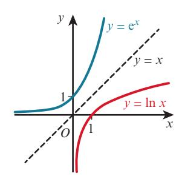

The curve $y = \ln x$ is the reflection of $y = e^x$ in the line $y = x$ .

$y = \ln x$ and $y = e^x$ are inverse functions.

All the rules of logarithms that we have learnt so far also apply for natural logarithms.

We say that $y = e^x \Leftrightarrow x = \log_e y$ .

If $y = e^x$ then $x = \ln y$

### KEY POINT 2.5

The Scottish mathematician John Napier (1550–1617) is credited with the discovery of logarithms. His original studies involved logarithms to the base of $\frac{1}{e}$ .

### DID YOU KNOW?

The number e is also known as Euler's number. It is named after Leonhard Euler (1707–1783), who devised the following formula for calculating the value of e:

$$e = 1 + \frac{1}{1} + \frac{1}{1 \times 2} + \frac{1}{1 \times 2 \times 3} + \frac{1}{1 \times 2 \times 3 \times 4} + \frac{1}{1 \times 2 \times 3 \times 4 \times 5} + \dots$$

### DID YOU KNOW?

The number $e$ is a very important number in Mathematics as it has very special properties. You will learn about these special properties in Chapters 4 and 5.

### FAST FORWARD

### EXERCISE 2G

**1** Use a calculator to evaluate correct to 3 significant figures:

<!-- CHECK: page 19: equation OCR failed, bbox [105, 125, 132, 141]: a e -->

$$e^{-3}$$

b      $e^{2.7}$

$$c = e^{0.8}$$

$$d = 0.8$$

e-2

**2** Use a calculator to evaluate correct to 3 significant figures:

a

$$\ln 3$$

b

$$\ln 1.4$$

c

$$\ln 0.9$$

<!-- CHECK: page 19: equation OCR failed, bbox [108, 167, 545, 182]: a ln3 b ln1.4 c ln 0.9 d ln 0.15 -->

**3** Without using a calculator, find the value of:

<!-- CHECK: page 19: equation OCR failed, bbox [105, 205, 140, 226]: a e -->

$$e^{-\ln 2} = \frac{1}{2} \ln 9$$

**c**

$$5e^{\ln 6}$$

**d**      **e**

<!-- CHECK: page 19: equation OCR failed, bbox [500, 205, 538, 223]: ln 1 2 − -->

**4** Solve.

<!-- CHECK: page 19: equation OCR failed, bbox [105, 250, 159, 267]: a e5 = -->

$$e^{\ln x} = 5$$

**b**      $\ln e^x = 15$

**c**

$$e^{3 \ln x} = 64$$

$$e^{3 \ln x} = 64$$

d      $e^{-\ln x} = 3$

**5** Solve, giving your answers correct to 3 significant figures.

<!-- CHECK: page 19: equation OCR failed, bbox [105, 291, 158, 307]: a e1 = 8 -->

$$e^x = 18$$

**b**      $e^{2x} = 25$

<!-- CHECK: page 19: equation OCR failed, bbox [367, 291, 421, 307]: c = + -->

$e^{x+1} = 8$ **d** $e^{2x-3} = 16$

**6** Solve, giving your answers in terms of natural logarithms.

<!-- CHECK: page 19: equation OCR failed, bbox [105, 331, 158, 348]: a e1 = 3 -->

$$e^x = 13$$

**b**      $e^{3x} = 7$

**c**

$$e^{2x-1} = 6$$

$e^{2x-1} = 6$ $d$ $e^{\frac{1}{2}x+3} = 4$

**7** Solve, giving your answers in terms of natural logarithms.

<!-- CHECK: page 19: equation OCR failed, bbox [105, 371, 158, 387]: a e10 -->

$$x > 10$$

**b**      $e^{5x-2} \leq 35$      **c**      $5x > 10$

**c**

$$5 \times e^{2x+3} < 1$$

**8** Solve, giving your answers correct to 3 significant figures.

a

$$\ln x = 5$$

b

$$\ln x = -4$$

**c**

$$\ln(x - 2) = 6$$

**a** $\ln x = 5$ **b** $\ln x = -4$ **c** $\ln(x - 2) = 6$ **d** $\ln(2x + 1) = -2$

**9** Solve, giving your answers correct to 3 significant figures.

**a**

$$\ln(3 - x^2) = 2 \ln x$$

a

$$\ln(3-x^2) = 2\ln x$$

b $2\ln(x+2) - \ln x = \ln(2x-1)$

**c**

$$2 \ln(x+1) = \ln(2x+3)$$

c

$$2\ln(x+1) = \ln(2x+3)$$

d $\ln(2x+1) = 2\ln x + \ln 5$

**e**

$$\ln(x + 2) - \ln x = 1$$

e

$$\ln(x+2) - \ln x = 1$$

**10** Express *y* in terms of *x* for each of these equations.

**a** $2 \ln(y+1) - \ln y = \ln(x+y)$ **b** $\ln(y+2) - \ln y = 1 + 2 \ln x$

**b**

$$\ln(y+2) - \ln y = 1 + 2 \ln x$$

**11** Solve, giving your answers in exact form.

**a**

$$e^{2x} + 2e^x - 15 = 0$$

$2^x + 2e^x - 15 = 0$ **b** $e^{2x} - 5e^x + 6 = 0$

<!-- CHECK: page 19: equation OCR failed, bbox [105, 596, 207, 612]: c 6e −− 13e5 = 0 -->

$2^x - 13e^x - 5 = 0$ $d$ $e^x - 21e^{-x} = 4$

**12** Given that the function $f$ is defined as $f : x \mapsto 5e^x + 2$ for $x \in \mathbb{R}$ , find an expression for $f^{-1}(x)$ .

**13 Solve** $2\ln(3 - e^{2x}) = 1$ , giving your answer correct to 3 significant figures.

**14** Solve the simultaneous equations, giving your answers in exact form.

**a**

$$2 \ln x + \ln y = 1 + \ln 5$$

$$\ln 10x - \ln y = 2 + \ln 2$$

**b**

$$e^{3x+4y} = 2e^{2x-y}$$

$$e^{2x+y} = 8e^{x+6}y$$

<!-- CHECK: page 19: OCR returned nothing for region bbox [90, 731, 230, 746] -->

**PS**

## 2.8 Transforming a relationship to linear form

When we collect experimental data for two variables we often wish to find a mathematical relationship connecting the variables. When the data plots on a graph lie on a straight line the relationship can be easily found using the equation $y = mx + c$ , where $m$ is the gradient and $c$ is the $y$ -intercept. It is more common, however, for the data plots to lie on a curve.

Logarithms can be used to convert some curves into straight lines.

This is the case for relationships of the form $y = kx^n$ and $y = k(a^x)$ where $k, a$ and $n$ are constants.

Logarithms to any base can be used but it is more usual to use those that are most commonly available on calculators, which are natural logarithms or logarithms to the base 10.

It is important to note:

- The variables $X$ and $Y$ in $Y = mX + c$ must contain only the original variables $x$ and $y$ . (They must **not** contain the unknown constants $a$ and $b$ .)
- The constants $m$ and $c$ must contain only the original unknown constants $a$ and $b$ . (They must **not** contain the variables $x$ and $y$ .)

### WORKED EXAMPLE 2.15

Convert $y = ae^{bx}$ , where $a$ and $b$ are constants, into the form $Y = mX + c$ .

#### Answer

$$y = ae^{bx}$$

**Taking natural logarithms of both sides gives:**

$$\ln y = \ln(ae^{bx})$$

$$\ln y = \ln a + \ln e^{bx}$$

$$\ln y = \ln a + bx$$

$$\ln y = bx + \ln a$$

Now compare $\ln y = bx + \ln a$ with $Y = mx + c$ :

$$\boxed{\ln y} = b - \boxed{x} + \ln a$$

$$Y = m X + c$$

The non-linear equation $y = ae^{bx}$ becomes the linear equation:

$$Y = mX + c$$

, where $Y = \ln y$ , $X = x$ , $m = b$ and $c = \ln a$

The variables $x$ and $y$ satisfy the equation $y = a(e^{-bx^2})$ , where $a$ and $b$ are constants. The graph of $\ln y$ against $x^2$ is a straight line passing through the points (0.55, 0.84) and (1.72, 0.26) as shown in the diagram.

<!-- CHECK: page 20: OCR returned nothing for region bbox [63, 707, 349, 721] -->

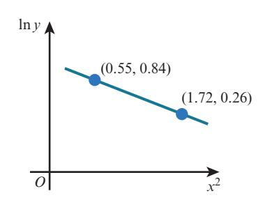

#### Answer

$$y = a \times e^{-bx^2}$$

##### Taking natural logarithms of both sides gives:

$$\ln y = \ln(a \times e^{-bx^2})$$

$$\ln y = \ln a + \ln e^{-bx^2}$$

$$\ln y = \ln a - bx^2$$

$$\ln y = -bx^2 + \ln a$$

Now compare $\ln y = -b x^2 + \ln a$ with $Y = mX + c$ :

$$\begin{array}{l} (\ln y) = -b \quad (x^2) + \ln a \\ \uparrow \quad \uparrow \quad \uparrow \\ Y = m \quad X + c \end{array}$$

Gradient =

$$m = \frac{0.26 - 0.84}{1.72 - 0.55} = -0.4957 \dots$$

$\therefore b = 0.50$ to 2 decimal places

Using $Y = mX + c$ , $X = 0.55$ , $Y = 0.84$ and $m = -0.4957 \dots$

<!-- CHECK: page 21: equation OCR failed, bbox [189, 331, 315, 346]: 0.84 0.4957 =− …×  0.55 + c -->

$$c = 1.1126 \dots$$

$$\therefore \ln a = 1.1126 \dots$$

$$a = e^{1.1126\dots}$$

Hence $a = 3.04$ and $b = 0.50$ to 2 decimal places.

When one variable on a graph is a log but the other variable is not a log, it is called a semi-log graph. When both variables on a graph are logs, it is called a log-log graph.

### DID YOU KNOW?

The table shows experimental values of the variables $x$ and $y$ .

a By plotting a suitable straight-line graph, show that $x$ and $y$ are related by the equation $y = k \times x^n$ , where $k$ and $n$ are constants.

b Use your graph to estimate the value of $k$ and the value of $n$ .

#### Answer

a

$$y = k \times x^n$$

$$\ln y = \ln(k \times x^n)$$

$$\ln y = \ln k + \ln x^n$$

$$\ln y = n \ln x + \ln k$$

##### Take natural logarithms of both sides.

|  |  |  |  |  |
| --- | --- | --- | --- | --- |
| **x** | 5 | 10 | 40 | 80 |
| **y** | 2593 | 1596 | 983 | 372 |

Use the multiplication law.

Use the power law.

The distributions of a diverse range of natural and man-made phenomena approximately follow the power law $y = ax^b$ . These include the size of craters on the moon, avalanches, species extinction, body mass, income and populations of cities.

### DID YOU KNOW?

Now compare $\ln y = n \ln x + \ln k$ with $Y = mX + c$ :

$$\boxed{\ln y} = n \boxed{\ln x} + \ln k$$

$$\begin{array}{l} \uparrow \\ Y = m \end{array} \quad \begin{array}{l} \uparrow \\ X + \end{array} \quad \begin{array}{l} \uparrow \\ c \end{array}$$

Hence the graph of $\ln y$ against $\ln x$ needs to be drawn where:

- gradient = $n$
- intercept on vertical axis = $\ln k$

Table of values is

The points form an approximate straight line, so $x$ and $y$ are related by the equation $y = k \times x^n$ .

**b**

$$n = \text{gradient} \approx \frac{5.92 - 7.86}{4.38 - 1.61} \approx -0.70$$

to 2 significant figures.

$\ln k$ = intercept on vertical axis

$$\ln k \approx 9$$

$$k \approx e^9$$

$$k \approx 8100$$

to 2 significant figures.

|  |  |  |  |  |
| --- | --- | --- | --- | --- |
| **In x** | 1,61 | 2,30 | 3,00 | 4,38 |
| **In y** | 7,86 | 7,38 | 6,89 | 5,92 |

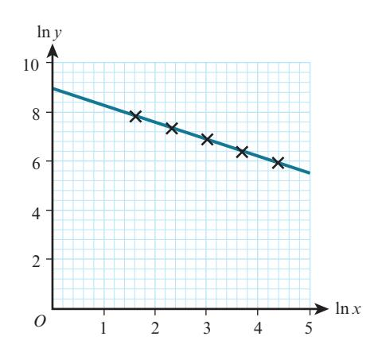

### EXERCISE 2H

**1** Given that $a$ and $b$ are constants, use logarithms to change each of these non-linear equations into the form $Y = mX + c$ . State what the variables $X$ and $Y$ and the constants $m$ and $c$ represent. (Note: there might be more than one method to do this.)

**a**

$$y = e^{ax+b}$$

$ax+b$ $\mathbf{b}$ $y = 10^{ax-b}$ $\mathbf{c}$ $y =$

**c**

$$y = a(x^{-b})$$

$$b^{-b}$$

**d**      $y = a(b^x)$

**E** e

$$a = e^{x^2+by}$$

**f**

$$x^a y^b = 8$$

$$a^a y^b = 8$$

**g**      $xa^y = b$

$$y = b$$

 $h = a(e^{-bx})$

**2** The variables $x$ and $y$ satisfy the equation $y = a \times x^n$ , where $a$ and $n$ are constants. The graph of $\ln y$ against $\ln x$ is a straight line passing through the points (0.31, 4.02) and (1.83, 3.22) as shown in the diagram. Find the value of $a$ and the value of $n$ correct to 2 significant figures.

- **3** The variables $x$ and $y$ satisfy the equation $y = k \times e^{n(x-1)}$

**4** Variables $x$ and $y$ are related so that, when $\log_{10} y$ is plotted on the vertical axis and $x$ is plotted on the horizontal axis, a straight-line graph passing through the points (2, 5) and (6, 11) is obtained.

a Express $\log_{10} y$ in terms of $x$ .

b Express $y$ in terms of $x$ , giving your answer in the form $y = a \times 10^{bx}$ .

**5** Variables $x$ and $y$ are related so that, when $\ln y$ is plotted on the vertical axis and $\ln x$ is plotted on the horizontal axis, a straight-line graph passing through the points (2, 4) and (5, 13) is obtained.

a Express $\ln y$ in terms of $x$ .

b Express $y$ in terms of $x$ .

**6** The variables $x$ and $y$ satisfy the equation $5^{2y} = 3^{2x+1}$ . By taking natural logarithms, show that the graph of $\ln y$ against $\ln x$ is a straight line, and find the exact value of the gradient of this line and state the coordinates of the point at which the line cuts the $y$ -axis.

**7** The mass, $m$ grams, of a radioactive substance is given by the formula $m = m_0 e^{-kt}$ , where $t$ is the time in days after the mass was first recorded and $m_0$ and $k$ are constants.

The table below shows experimental values of $t$ and $m$ .

|  |  |  |  |  |  |
| --- | --- | --- | --- | --- | --- |
| *t* | 10 | 20 | 30 | 40 | 50 |
| *m* | 40.9 | 33.5 | 27.4 | 22.5 | 18.4 |

a Draw the graph of $\ln m$ against $t$ .

b Use your graph to estimate the value of $m_0$ and $k$ .

c The half-life of a radioactive substance is the time it takes to decay to half of its original mass. Find the half-life of this radioactive substance.

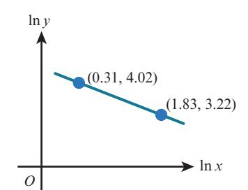

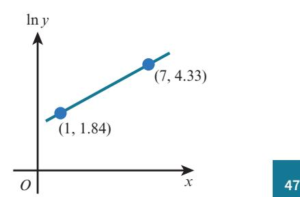

**8** The temperature, $T^{\circ}\text{C}$ , of a hot drink, $t$ minutes after it is made, can be modelled by the equation $T = 25 + ke^{-nt}$ , where $k$ and $n$ are constants. The table below shows experimental values of $t$ and $T$ .

|  | *t* | 2 | 4 | 6 | 8 | 10 |
| --- | --- | --- | --- | --- | --- | --- |
| *T* | 63.3 | 57.7 | 52.8 | 48.7 | 45.2 |  |

**a** Convert the equation to a form suitable for drawing a straight-line graph.
**b** Draw the straight-line graph and use it to estimate the value of $k$ and $n$ .
**c** Estimate:
**i** the initial temperature of the drink
**ii** the time taken for the temperature to reach 28 °C
**iii** the room temperature.

## Checklist of learning and understanding

### The rules of logarithms

- If $y = a^x$ then $x = \log_a y$ .
- $\log_a a = 1$ , $\log_a 1 = 0$ , $\log_a a^x = x$ , $a^{\log_a x} = x$
- Product rule: $\log_a(xy) = \log_a x + \log_a y$
- Division rule: $\log_a\left(\frac{x}{y}\right) = \log_a x - \log_a y$
- Power rule: $\log_a(x)^m = m \log_a x$
- Special case of power rule: $\log_a\left(\frac{1}{x}\right) = -\log_a x$

### Natural logarithms

- Logarithms to the base of $e$ are called natural logarithms.
- e ≈ 2.718
- $\ln x$ is used to represent $\log_e x$ .
- If $y = e^x$ then $x = \ln y$ .
- All the rules of logarithms apply for natural logarithms.

### Transforming a relationship to linear form

- Logarithms can be used to convert relationships of the form $y = kx^n$ and $y = k(a^x)$ , where $k$ , $a$ and $n$ are constants, into straight lines of the form $Y = mX + c$ , where $X$ and $Y$ are functions of $x$ and of $y$ .

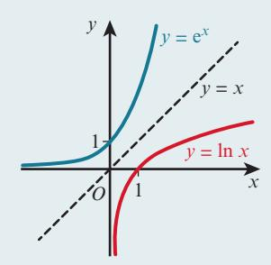

**1** Solve the inequality $2^x > 7$ , giving your answer in terms of logarithms. **[2 marks]**
**2** Given that $\ln p = 2 \ln q - \ln(3 + q)$ and that $q > 0$ , express $p$ in terms of $q$ not involving logarithms. **[3 marks]**
**3** Solve the inequality $3 \times 2^{3x+2} < 8$ , giving your answer in terms of logarithms. **[4 marks]**

**4** Use logarithms to solve the equation

$$5^{x+3} = 7^{x-1},$$

giving the answer correct to 3 significant figures. **[4 marks]**

*Cambridge International AS & A Level Mathematics 9709 Paper 21 Q1 November 2015*

**5** Solve the equation $6(4^x) - 11(2^x) + 4 = 0$ , giving your answers for $x$ in terms of logarithms where appropriate. **[5 marks]**

**6** Solve the equation $\ln(5x + 4) = 2\ln x + \ln 6$ . **[5 marks]**

**7**

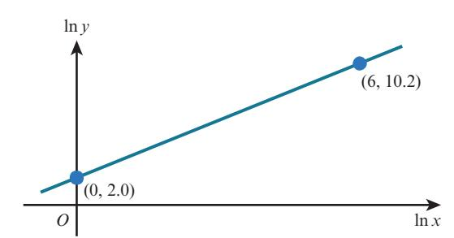

The variables $x$ and $y$ satisfy the equation $y = Kx^m$ , where $K$ and $m$ are constants. The graph of $\ln y$ against $\ln x$ is a straight line passing through the points (0, 2.0) and (6, 10.2), as shown in the diagram. Find the values of $K$ and $m$ , correct to 2 decimal places.

*Cambridge International AS & A Level Mathematics 9709 Paper 21 Q3 June 2011*

$$2^x + 3(2^{-x}) = 4$$

can be written in the form

$$y^2 - 4y + 3 = 0.$$

**[3 marks]**

**ii** Hence solve the equation

$$2^x + 3(2^{-x}) = 4,$$

giving the values of *x* correct to 3 significant figures where appropriate. **[3 marks]**

*Cambridge International AS & A Level Mathematics 9709 Paper 21 Q5 June 2010*

**9** Given that $(1.2)^x = 6^y$ , use logarithms to find the value of $\frac{x}{y}$ correct to 3 significant figures. **[3 marks]**

**10** The polynomial f(*x*) is defined by

<!-- CHECK: page 26: equation OCR failed, bbox [125, 660, 255, 677]: f( )1 =+ 2254 −− 12. 32 xx xx -->

Show that $f(-2) = 0$ and factorise $f(x)$ completely. **[4 marks]**

<!-- CHECK: page 26: OCR returned nothing for region bbox [96, 699, 573, 727] -->

<!-- CHECK: page 26: OCR returned nothing for region bbox [256, 730, 574, 745] -->

## END-OF-CHAPTER REVIEW EXERCISE 2

**11** Solve the equation $|4 - 2^x| = 10$ , giving your answer correct to 3 significant figures. **[3 marks]**

*Cambridge International A Level Mathematics 9709 Paper 31 Q1 June 2011*
**12** Use logarithms to solve the equation $e^x = 3^{x-2}$ , giving your answer correct to 3 decimal places. **[3 marks]**

*Cambridge International A Level Mathematics 9709 Paper 31 Q1 November 2014*
**13** Using the substitution $u = 3^x$ , solve the equation $3^x + 3^{2x} = 3^{3x}$ giving your answer correct to 3 significant figures. **[5 marks]**

*Cambridge International A Level Mathematics 9709 Paper 31 Q2 November 2015*
**14** The variables $x$ and $y$ satisfy the equation $5^y = 3^{2x-4}$ .

**a** By taking natural logarithms, show that the graph of $y$ against $x$ is a straight line and find the exact value of the gradient of this line.

**b** This line intersects the $x$ -axis at $P$ and the $y$ -axis at $Q$ . Find the exact coordinates of the midpoint of $PQ$ . **[3 marks]**

**15**

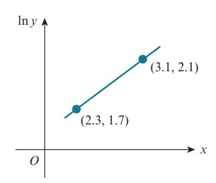

The variables $x$ and $y$ satisfy the equation $y = K(b^x)$ , where $K$ and $b$ are constants. The graph of $\ln y$ against $x$ is a straight line passing through the points (2.3, 1.7) and (3.1, 2.1), as shown in the diagram. Find the values of $K$ and $b$ , correct to 2 decimal places. **[6 marks]**
